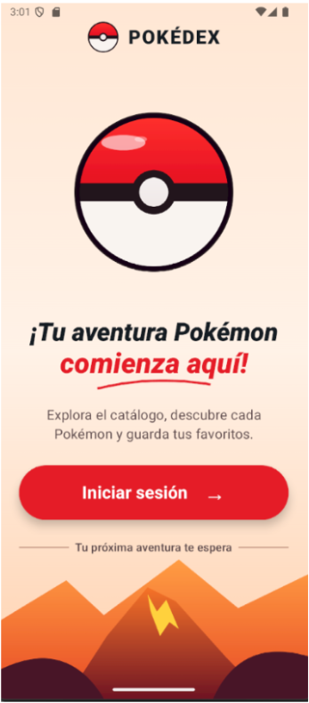
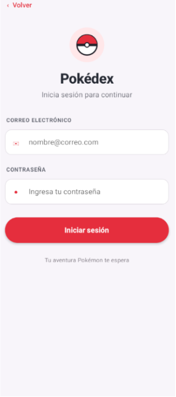
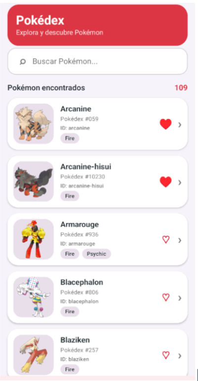
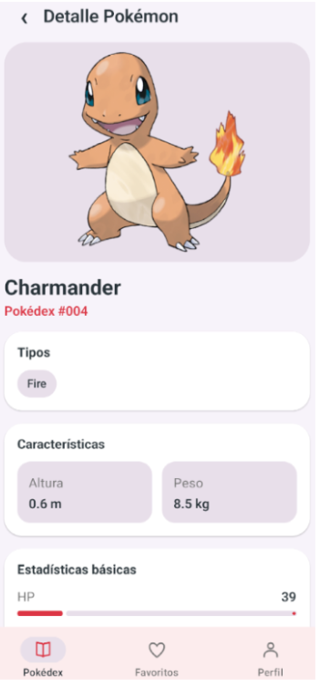
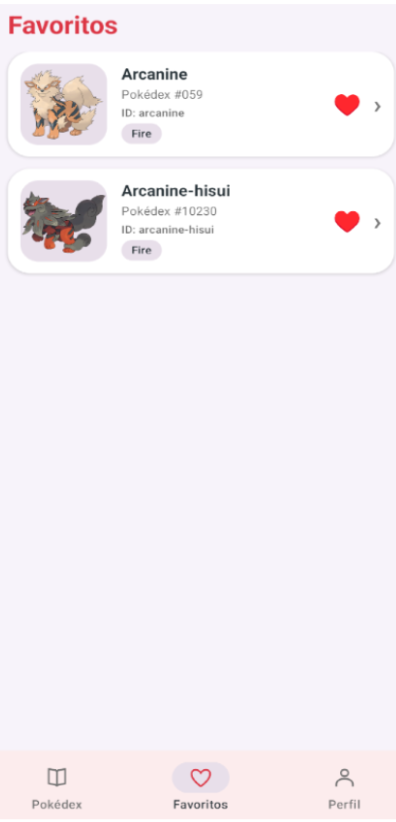
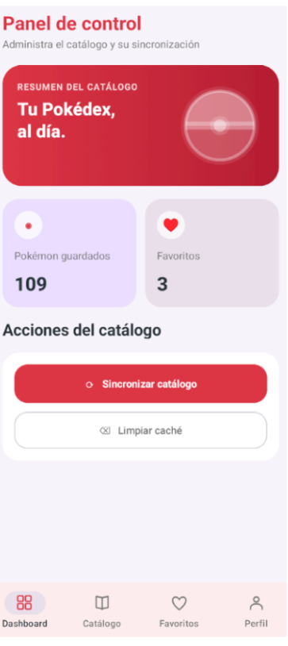
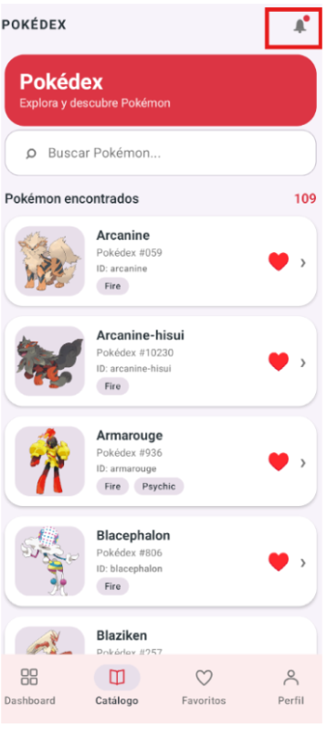

# Pokédex Pokémon

Aplicación Android para explorar Pokémon de tipo fuego, consultar sus detalles y guardar favoritos. El proyecto usa Jetpack Compose para la interfaz, Firebase para autenticación y roles, Room para conservar el catálogo local y PokéAPI como fuente de datos.

## Capturas

| Pantalla | Captura |
|---|---|
| Bienvenida |  |
| Inicio de sesión |  |
| Catálogo de Pokémon de tipo fuego |  |
| Detalle de un Pokémon |  |
| Favoritos |  |
| Panel de administración |  |
| Acceso a notificaciones desde el catálogo |  |

## Funcionalidades

- Inicio de sesión con correo y contraseña mediante Firebase Authentication.
- Roles `admin` y `usuario` consultados en Firestore.
- Catálogo de Pokémon de tipo fuego desde [PokéAPI](https://pokeapi.co/).
- Detalles con ilustración, tipos, características, estadísticas y habilidades.
- Catálogo y favoritos persistidos en Room; el catálogo guardado puede consultarse sin conexión.
- Panel de administración para sincronizar el catálogo, ver totales y limpiar la caché local.
- Notificación al terminar la sincronización, sujeta al permiso de notificaciones de Android.
- Interfaz desarrollada con Jetpack Compose y Material 3.

## Requisitos

- Android Studio compatible con Android Gradle Plugin `9.3.3`.
- Android SDK Platform `37`.
- JDK `25` (el proyecto configura el toolchain de Gradle para esta versión).
- Una configuración de Firebase para Android con el identificador `com.tecsup.catalogo_pokemon`.

## Configuración de Firebase

1. Crea o selecciona un proyecto en Firebase y registra una aplicación Android con el identificador `com.tecsup.catalogo_pokemon`.
2. Descarga el archivo `google-services.json` y colócalo en `app/google-services.json`. Este archivo está excluido de Git porque contiene configuración propia del proyecto Firebase.
3. Habilita el proveedor **Correo electrónico/contraseña** en Firebase Authentication y crea las cuentas que usarán la aplicación.
4. En Cloud Firestore, crea la colección `usuarios`. Para cada cuenta, crea un documento cuyo ID sea su UID de Firebase Authentication y agrega el campo `rol` con el valor `admin` o `usuario`.
5. Configura las reglas de Firestore para que cada persona pueda leer solo su perfil. Por ejemplo, si la app solo necesita leer perfiles, puedes denegar las escrituras desde el cliente:

   ```text
   rules_version = '2';
   service cloud.firestore {
     match /databases/{database}/documents {
       match /usuarios/{uid} {
         allow read: if request.auth != null && request.auth.uid == uid;
         allow write: if false;
       }
     }
   }
   ```

   Crea y cambia los roles desde Firebase Console o desde un entorno confiable. No permitas que una persona cambie su propio campo `rol` desde la app.

La aplicación espera el documento `usuarios/{uid}` para recuperar el rol. Si falta el documento o el rol tiene otro valor, no se completará el inicio de sesión.

## Compilar y ejecutar

Abre el proyecto en Android Studio, espera a que termine la sincronización de Gradle y ejecuta la configuración `app` en un emulador o dispositivo con Android 7.0 (API 24) o superior.

También puedes usar el wrapper desde la raíz del repositorio:

### Windows (PowerShell)

```powershell
.\gradlew.bat :app:assembleDebug
.\gradlew.bat :app:installDebug
```

### macOS o Linux

```bash
./gradlew :app:assembleDebug
./gradlew :app:installDebug
```

El APK de depuración se genera en `app/build/outputs/apk/debug/app-debug.apk`.

## Estructura del proyecto

```text
app/src/main/java/com/tecsup/catalogo_pokemon/
├── data/
│   ├── auth/          # Firebase Authentication y perfiles Firestore
│   ├── local/         # Entidades, DAO y base de datos Room
│   ├── mapper/        # Conversión entre DTO, entidades y dominio
│   ├── remote/        # Cliente Retrofit y DTO de PokéAPI
│   └── repository/    # Repositorio del catálogo
├── domain/model/      # Modelos Item y Sesion/Rol
├── notification/      # Notificaciones de sincronización
└── ui/                # Pantallas Compose, ViewModels, navegación y tema
```

## Tecnologías

- Kotlin y Android Gradle Plugin.
- Jetpack Compose y Material 3.
- Firebase Authentication y Cloud Firestore.
- Room con KSP.
- Retrofit, OkHttp y Kotlin Serialization.
- Coroutines y StateFlow.
